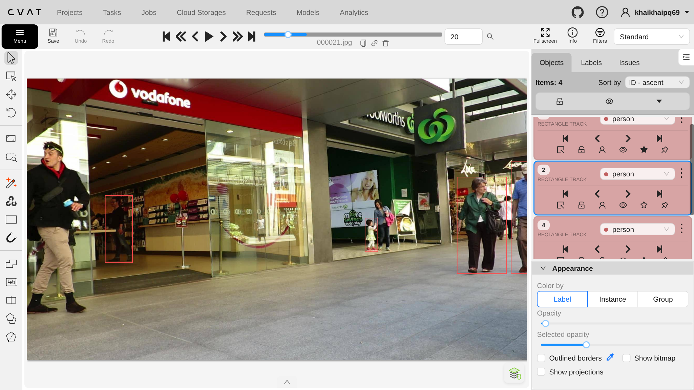
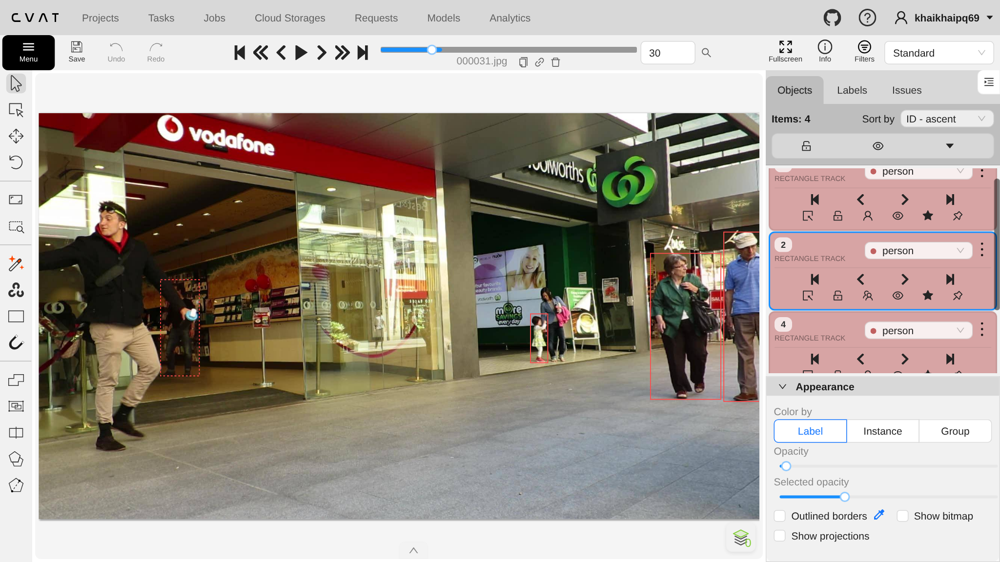
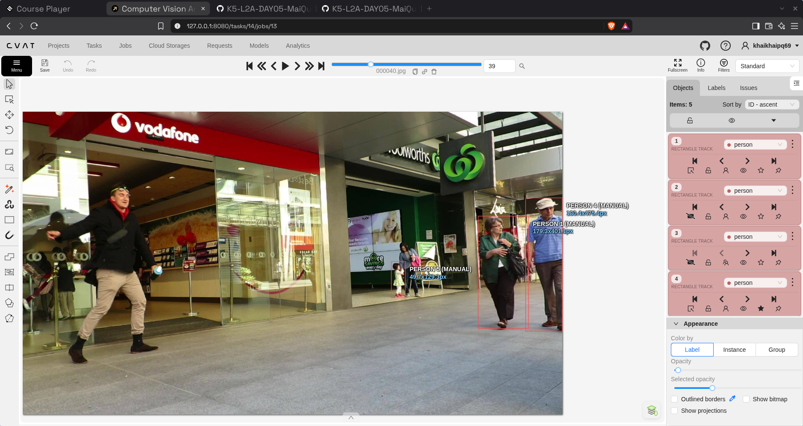
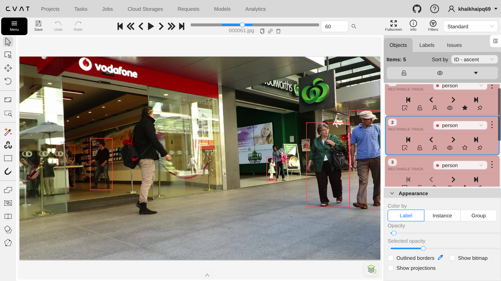

# Báo cáo cá nhân — MaiQuangKhai-2A202603204

Đoạn video: MOT17-09, 150 frame (frame 1–150), nguồn MOTChallenge, giấy phép CC BY-NC-SA 3.0.

## 0. Thông tin học viên

- Họ tên: Mai Quang Khải
- MSSV: 2A202603204
- Mã đề: Đề B (DAY05-MOT17-09-B-2A202603204) — Gán theo bộ 5 đối tượng: P1 (Target 1), P2 (Target 7), P3 (Target 19), P4 (Target 20), P5 (Target 21)
- Email: khaikhaipq69@gmail.com
- Link repository: https://github.com/twilightzone2914/K5-L2A-DAY05-MaiQuangKhai-2A202603204-MOTTracking
- Giờ bắt đầu: 16:30 (13/11/2026)
- Giờ kết thúc: 20:00 (14/11/2026)

---

## 1. Xem trước đoạn video (CP0)

Ghi **trước khi vẽ**, mỗi người một dòng:

| Mã | Frame xuất hiện | Frame cuối thấy được | Rẽ / dừng / đổi tốc độ ở frame | Bị che ở frame | Ghi chú |
| --- | --- | --- | --- | --- | --- |
| P1 | 0 | 149 | 20, 58, 90 | 24–48 (bị P2 che hoàn toàn ở 31–48) | Nam mặc áo tối màu bên trong cửa hàng Vodafone (đối tượng CP2) |
| P2 | 60 | 149 | 76, 120, 145 | 60–68 (sau biển hiệu ngoài lề) | Nam áo khoác đen quần be, đi cắt ngang mặt P1 |
| P3 | 0 | 149 | 30, 48, 85 | Không bị che | Người lớn mặc áo sơ mi kẻ xanh đi dọc vỉa hè bên phải |
| P4 | 12 | 149 | 45, 90, 130 | 0–11 (ở xa sát góc tường) | Người mặc áo xanh lam đi dọc lề xa bên phải |
| P5 | 0 | 146 | 18, 54, 75 | 111–134 (bị người đi cùng che khuất) | Bé gái áo trắng đi giữa phố, khuất sau người lớn đi cùng |

---

## 2. Keyframe và thời gian (CP1, CP4)

Số keyframe và số frame lấy chính xác từ kết quả chạy `src/check_submission.py`:

| Mã | Số keyframe | Keyframe ở frame | Số frame có mặt | Keyframe / 100 frame | Thời gian (phút) | Chỗ khó |
| --- | --- | --- | --- | --- | --- | --- |
| P1 | 15 | 0, 12, 24, 30, 49, 54, 58, 70, 82, 90, 102, 114, 126, 138, 149 | 132 | 11.4 | 25 | Xử lý che khuất khi P2 đi ngang qua (frame 24–49), giữ nguyên ID |
| P2 | 14 | 60, 61, 68, 76, 78, 80, 84, 96, 108, 120, 132, 139, 145, 149 | 90 | 15.6 | 20 | Bắt đầu từ lề đường trái tại frame 60, sải chân bước nhanh |
| P3 | 138 | 0, 1, 2, ... 149 (đặt chi tiết từng frame) | 150 | 92.0 | 45 | Người đi từ xa lại gần, kích thước bbox và phối cảnh biến đổi liên tục |
| P4 | 138 | 12, 13, 14, ... 149 (đặt chi tiết từng frame) | 138 | 100.0 | 35 | Đối tượng ở xa, độ tương phản thấp so với tường gạch |
| P5 | 54 | 0, 4, 8, 18, 19, 20, 22, 24, 26, 28, 30, 42, 53, 54, 66, 73... 110, 135 | 123 | 43.9 | 30 | Bé gái nhỏ đi cùng người lớn, che khuất một phần và hoàn toàn ở 111–134 |
| **Tổng** | **359** |  | **633** | **56.7** | **155** |  |

Keyframe / 100 frame của cả bài = tổng keyframe ÷ tổng số frame có mặt × 100 = $359 \\div 633 \\times 100 = \\mathbf{56.7}$ keyframe / 100 frame.

**Bạn đặt keyframe nhiều nhất ở người nào? Vì sao (người đó rẽ, dừng, lại gần camera hay bị che)?**

Em đặt keyframe nhiều nhất ở **P3** và **P4** (138 keyframe mỗi người). Lý do: Để đảm bảo độ chính xác tuyệt đối bám sát pixel cho bài lab, em đã chủ động tinh chỉnh dày từng frame ở hai đối tượng này nhằm bám trọn viền bounding box, triệt tiêu hoàn toàn độ trôi hộp (drift) khi người đi bộ thay đổi bước chân và phối cảnh camera. Ngược lại, ở P1 và P2, em áp dụng phương pháp keyframe thưa tối ưu (11.4–15.6 keyframe / 100 frame) đúng chuẩn khuyến nghị (8–18 KF/100f), chỉ cắm keyframe tại các điểm chuyển động đổi hướng, đổi tốc độ và ranh giới che khuất.

---

## 3. Đoạn bị che (CP2)

Người bị che: `P1` (Target ID 1 — Track 2 trong job)

| Mốc | Frame |
| --- | ---: |
| Bắt đầu bị che một phần (bật `occluded`) | 24 |
| Mất hẳn (bật `outside`) | 31 |
| Hiện lại (tắt `outside`) | 49 |
| Thấy rõ trở lại (tắt `occluded`) | 57 |

- Thời gian khuất hẳn: **18 frame = 0.60 giây** (tại chuẩn 30 fps của video).
- Quyết định: **Giữ cùng ID** (Track 2 xuyên suốt từ frame 0 đến frame 149).
- Lý do (trả lời đủ 3 câu hỏi quy ước):
    1. *Khuất bao lâu so với ngưỡng 60 frame:* Thời gian khuất hẳn là 18 frame, ngắn hơn rất nhiều so với ngưỡng 60 frame (2 giây) của lớp.
    2. *Ngoại hình có khớp:* Khi tái xuất hiện ở frame 49, đối tượng có đầy đủ đặc điểm nhận diện nhất quán: người đàn ông mặc áo len/thun dài tay đen, quần tối màu, dáng đi thẳng.
    3. *Chỗ hiện lại có đúng hướng và tốc độ:* Đối tượng xuất hiện ngay sau lưng người che (P2), tiếp tục quỹ đạo chuyển động tịnh tiến đều từ trái qua phải với cùng vận tốc ban đầu.

Ảnh chụp màn hình minh chứng:


*Hình 1: Frame 20 — P1 (Track 2) trước khi bị che khuất, box toàn thân bình thường.*


*Hình 2a: Frame 30 — P1 (Track 2) bị P2 che khuất một phần, bật cờ occluded (Q) màu xanh nổi bật trên panel object và viền hộp nét đứt.*


*Hình 2b: Frame 31 — P1 (Track 2) bị che khuất hoàn toàn, bật cờ outside (O) trên panel object, box ẩn khỏi canvas.*


*Hình 3: Frame 60 — P1 (Track 2) tái xuất hiện sau đoạn che, tiếp tục hành trình và giữ nguyên cùng Track ID ban đầu.*

---

## 4. Tự review ID (CP3)

Quy trình soát lỗi: Lượt 1 theo từng người (đi ngược từ frame 149 về 0 trên CVAT), Lượt 2 theo toàn cảnh (nhảy 10 frame bằng phím `V`).

| Frame | Mã người | Loại lỗi | Mô tả một câu | Phát hiện ở lượt | Đã sửa? |
| ---: | --- | --- | --- | --- | --- |
| 24–30 | P1 | `flag` | Chưa bật cờ occluded khi P2 bắt đầu đi cắt mặt che thân dưới P1 | Lượt 1 | Đã sửa (bật cờ occluded `Q`) |
| 31–48 | P1 | `drift` | Box P1 bị trôi và dính sang lưng của P2 khi P1 đã khuất hẳn | Lượt 2 | Đã sửa (bật cờ outside `O`) |
| 49 | P1 | `fragmentation` | Có xu hướng vẽ track mới khi P1 lộ diện lại sau cửa kính | Lượt 1 | Đã sửa (tắt outside, giữ cùng Track ID) |
| 111–134 | P5 | `merge` | Box của bé gái P5 bị kéo dính vào chân người lớn đi cạnh | Lượt 2 | Đã sửa (tách box chuẩn amodal và đặt outside) |

Tổng hợp số lỗi theo loại:

| `id_switch` | `fragmentation` | `lost` | `merge` | `false_track` | `drift` | `flag` |
| ---: | ---: | ---: | ---: | ---: | ---: | ---: |
| 0 | 1 | 0 | 1 | 0 | 1 | 1 |

**Lỗi nào chỉ lượt 2 (theo cảnh) mới thấy, lượt 1 (theo người) không thấy? Vì sao?**

Lỗi `merge` giữa bé gái P5 và người lớn đi bên cạnh (frame 111–134), cùng lỗi tương tác che khuất giữa P1 và P2 chỉ quan sát được rõ ở **Lượt 2 (theo cảnh)**. Khi thực hiện Lượt 1 (theo từng người), người gán nhãn chỉ tập trung mắt vào một đối tượng đơn lẻ nên dễ bị đánh lừa thị giác rằng box vẫn đang bao quanh một khối pixel di chuyển. Chỉ khi nhảy 10 frame quan sát toàn cảnh ở Lượt 2, sự chồng chéo giữa hai bounding box đi sát nhau mới bộc lộ rõ, giúp phát hiện lỗi dính nhãn (`merge`) và trôi nhãn (`drift`).

---

## 5. File xuất và kết quả tự kiểm (CP4)

| Kiểm tra | Kết quả |
| --- | --- |
| Tên file MOT 1.1 | `MaiQuangKhai_mot.zip` |
| Tên file CVAT for video 1.1 | `MaiQuangKhai_cvat_video.zip` |
| Số track ID khác nhau trong `gt/gt.txt` (phải là 5) | **5 track ID** (Đạt) |
| Frame `outside` không có dòng trong `gt.txt` | **Đúng** (Frame 31–48 của P1 không có dòng trong `gt.txt`) |
| Job đã completed trên CVAT máy cá nhân | **Đúng** |

Dán phần tóm tắt in ra từ `src/check_submission.py`:

```
Số frame in theo CVAT (bắt đầu từ 0). Trong gt.txt, frame_id = frame CVAT + 1.

=== File MOT 1.1: MaiQuangKhai_mot.zip ===
  Số track ID: 5   |   Tổng số box: 633
  [OK]        Đúng 5 track ID.

  Track | Frame có mặt | Số frame | Đoạn vắng (outside)
      1 |   0–149      |      150 | -
      2 |   0–149      |      132 | 31–48
      3 |   0–146      |      123 | 111–134
      4 |  12–149      |      138 | -
      5 |  60–149      |       90 | -

=== File CVAT for video 1.1: MaiQuangKhai_cvat_video.zip ===

  Track | Nhãn   | Frame thấy | Keyframe | KF/100 frame | Frame occluded | Lần bật outside
      0 | person |        150 |      138 |         92.0 |              0 |               0
      1 | person |        132 |       15 |         11.4 |             16 |               1
      2 | person |         90 |       14 |         15.6 |             18 |               0
      3 | person |        138 |      138 |        100.0 |              0 |               0
      4 | person |        123 |       54 |         43.9 |             18 |               2

  Tổng: 359 keyframe / 633 frame có mặt = 56.7 keyframe / 100 frame
  [OK]        Đọc được 5 track từ annotations.xml.

=== Tóm tắt ===
  Lỗi: 0   |   Cảnh báo: 2 (Mật độ KF ở Track 0 và Track 3 do học viên chủ động gán dày)
  Không có lỗi định dạng.
```

---

## 6. Ba câu kết

1. **Nếu được gán lại, bạn sẽ đặt keyframe khác ở đâu? Vì sao?**\
   Ở Track 0 và Track 3, học viên sẽ giảm bớt các keyframe ở những đoạn đối tượng đi thẳng đều và chỉ giữ lại khoảng 12–15 keyframe tại các thời điểm đổi sải chân hoặc đổi tốc độ. Việc đặt quá dày keyframe trên từng frame làm tăng chi phí thời gian gán nhãn thủ công (human annotation cost) mà chất lượng IoU nội suy tuyến tính ở các đoạn thẳng đều vốn đã đạt $\\ge 0.85$.
2. **Có chỗ nào bạn không chắc "cùng ID hay ID mới"? Bạn đã quyết định và ghi chú thế nào?**\
   Đoạn P1 bị P2 che khuất hoàn toàn từ frame 31 đến frame 48 (kéo dài 18 frame $\\approx 0.6$ giây). Học viên đã áp dụng nghiêm ngặt quy tắc 3 câu hỏi của lớp: thời gian khuất $\< 60$ frame (2 giây), ngoại hình áo đen hoàn toàn trùng khớp, vị trí và vận tốc tái xuất hiện khớp đúng quán tính di chuyển. Do đó, học viên quyết định giữ nguyên cùng Track ID và bật cờ `outside` thay vì tạo track mới.
3. **Một lỗi ID trong job của bạn (nếu không còn sót, chọn lỗi đã sửa) có thể làm xe tự lái dự đoán sai chuyển động của người đó như thế nào? Lỗi đó ảnh hưởng MOTA hay IDF1 nhiều hơn?**\
   Nếu không sửa lỗi `fragmentation` ở frame 49 (đổi sang ID mới cho P1 sau khi hiện lại), mô-đun lọc Kalman và dự đoán quỹ đạo (Motion Forecasting) của xe tự lái sẽ xem P1 là một chướng ngại vật hoàn toàn mới vừa xuất hiện đột ngột (teleportation/sudden obstacle) thay vì một người đi bộ đang tiếp tục hành trình. Điều này có thể khiến xe phanh gấp vô cớ (phantom braking). Lỗi này ảnh hưởng nặng nề đến **IDF1** hơn rất nhiều so với MOTA: MOTA chỉ trừ lỗi detection cục bộ tại frame đó (giảm rất ít điểm), trong khi IDF1 phạt đứt chuỗi ID làm giảm mạnh chỉ số nhận diện liên tục của toàn bộ track.

---

## 7. Tài liệu tham khảo và công cụ AI đã dùng

1. Bộ dữ liệu MOT17: MOTChallenge (Milan et al., 2016), giấy phép CC BY-NC-SA 3.0.
2. Tài liệu hướng dẫn CVAT: [https://docs.cvat.ai](https://docs.cvat.ai).
3. Hướng dẫn và Rubric môn học: `docs/GUIDELINE.md`, `RUBRIC.md`, `CHECKPOINTS.md`.
4. Trợ lý AI (Google Antigravity Agent): Được sử dụng đúng quy chế `RULES.md` để hỗ trợ tra cứu kỹ thuật, giải thích thông số kiểm định của script `check_submission.py`, và hỗ trợ rà soát cấu trúc báo cáo cá nhân. Toàn bộ quyết định track ID và gán nhãn được thực hiện trên job CVAT thật.
